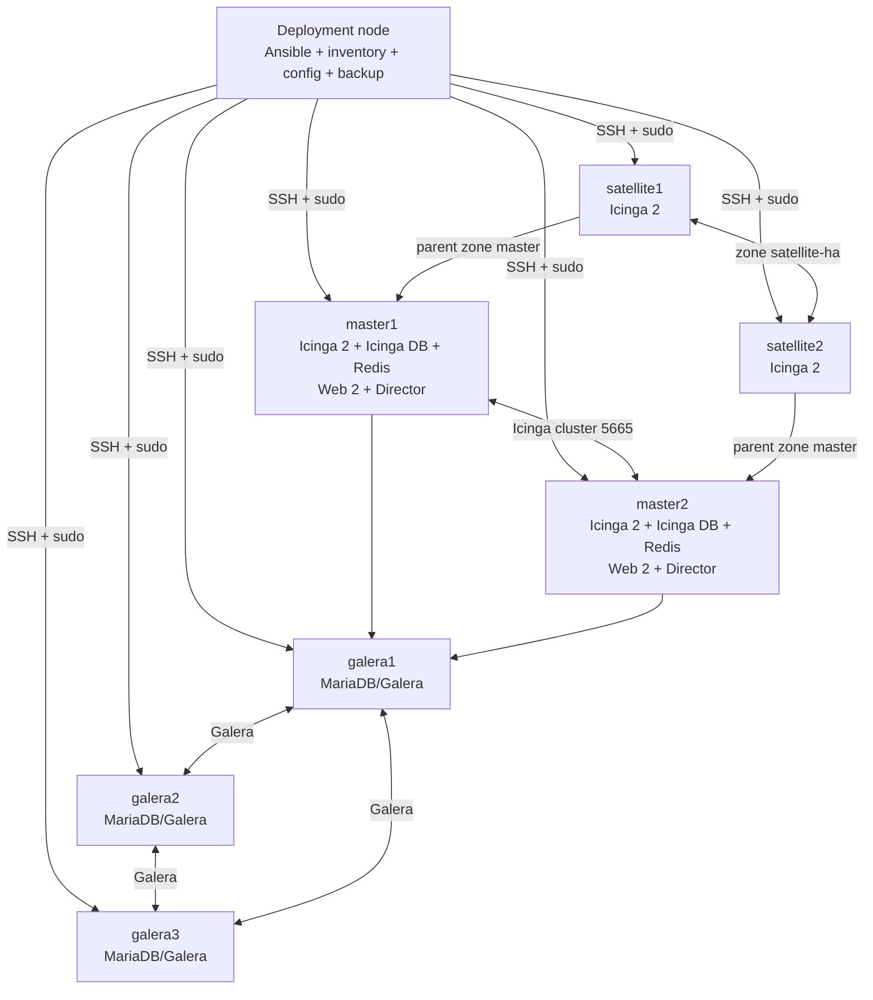

# Runbook triển khai và vận hành Icinga bằng Ansible

> Tài liệu vận hành độc lập cho project `icinga-ansible`.
>
> Phạm vi đã kiểm tra sâu: 2 Icinga master, tối đa 2 satellite trong một zone HA, 3 MariaDB Galera,
> Icinga DB, Redis và Icinga Web 2. Director chỉ được cài/enable ở tầng hạ tầng; project không quản lý
> object monitoring. Deployment node là máy quản trị riêng, không nằm trong inventory dịch vụ.
>
> Cập nhật theo regression thật trên OpenStack ngày **2026-10-22**: thêm/xóa master, thêm hai
> satellite rồi xóa lần lượt, backup-full và dựng lại cluster mới 2 master + 3 Galera từ backup.

## 1. Mục tiêu và phạm vi hỗ trợ

Runbook này hướng dẫn toàn bộ vòng đời:

- chuẩn bị deployment node và các service node;
- deploy mới một cụm Icinga;
- thêm hoặc xóa master/satellite;
- kiểm tra Icinga, Web, Director, Redis và Galera;
- backup cấu hình, database và PKI;
- restore database để rollback hoặc phục hồi sự cố;
- cứu Galera khi toàn bộ cluster dừng bất thường;
- disaster recovery khi mất toàn bộ service node nhưng còn deployment node và DB backup;
- disaster recovery khi chỉ còn physical DB backup;
- upgrade trong cùng dòng phiên bản và lên dòng cao hơn;
- rollback bằng physical backup trước upgrade;
- mô tả chi tiết các lỗi đã sửa và các case đã test thật.

Project hiện hỗ trợ các topology chính sau:

| Thành phần | Topology được hỗ trợ |
|---|---|
| Icinga master | 1 hoặc 2 master |
| Satellite zone | Mỗi zone có 1 hoặc 2 satellite |
| Managed MariaDB | 1 node standalone hoặc số lẻ từ 3 node Galera trở lên |
| Database ngoài | Có hỗ trợ deploy dịch vụ, nhưng DBA phải tự backup, restore và migrate schema |
| Load balancer | Role tích hợp chưa hoàn thiện; dùng LB/reverse proxy ngoài nếu cần VIP Web |

Các giới hạn được kiểm tra cứng trong `prechecks`:

- không cho hơn 2 endpoint trong zone `master`;
- không cho satellite zone rỗng hoặc có hơn 2 member;
- mọi member của `satellite_zones` phải nằm trong group `[satellite]`;
- tên zone phải duy nhất, mỗi satellite thuộc đúng một zone và tên zone không được trùng zone client;
- endpoint thuộc đúng một trong ba role master/satellite/client và mọi service host thuộc `all_hosts`;
- managed DB chỉ chấp nhận 1 node hoặc số lẻ từ 3 node;
- bắt buộc khai đủ tag của 5 image;
- nhánh external DB phải có host và credential service đã được DBA tạo trước.

## 2. Các quy tắc an toàn phải nhớ

1. Chạy CLI bằng **user thường có passwordless sudo**. Không chạy cả câu lệnh bằng `sudo` và không `sudo su` trước khi chạy. Nếu chạy bằng root, Ansible thường dùng `/root/.ssh` và không SSH được sang các node khác.
2. Không sửa file template trong `etc/examples/`. Cấu hình thật nằm ở `/etc/icinga-ansible` trên deployment node.
3. Không đặt deployment node vào inventory nếu nó không chạy workload Icinga/MariaDB.
4. Chỉ chạy `bootstrap-servers` trên host hoàn toàn mới hoặc host chưa từng được bootstrap.
5. Trước mọi thao tác upgrade, restore, recovery hoặc thay topology, chạy `backup-full` và sao chép backup ra storage ngoài deployment node.
6. `restore-backup`, `recover-db-only`, `remove-*`, `rollback` và `destroy` là thao tác có gián đoạn hoặc phá hủy dữ liệu. Dùng đúng chuỗi xác nhận được ghi trong từng phần.
7. Restore physical MariaDB lần đầu bằng đúng version MariaDB đã tạo backup. Chỉ upgrade sau khi restore và `check` đã PASS.
8. Không downgrade MariaDB/Galera tại chỗ. Rollback phải trả tag cũ rồi restore physical backup `pre-upgrade`.
9. Không đặt VIP/LB trước cổng Icinga cluster 5665. Nếu dùng LB, chỉ đặt trước Web và bật sticky session vì Icinga Web dùng PHP file session.
10. Backup còn nằm trên chính deployment node chưa phải backup DR. Phải đồng bộ sang storage độc lập.
11. Inventory thường nằm trong repo nên không thuộc `config-*.tar.gz`; lưu inventory/host vars và
    revision code riêng cùng bundle DR.
12. `zones.d`, package static monitoring và credential nằm ngoài `/etc/icinga-ansible` không thuộc
    `backup-full`; operator phải backup/restore bằng pipeline riêng.

## 3. Kiến trúc mong muốn



Deployment node giữ desired state và artifact DR:

| Dữ liệu | Vị trí mặc định | Ý nghĩa |
|---|---|---|
| Global settings | `/etc/icinga-ansible/globals.yml` | topology logic, version, module, DB, proxy |
| Secrets | `/etc/icinga-ansible/passwords.yml` | DB, Redis, API và Web admin của hạ tầng |
| Override | `/etc/icinga-ansible/config/` | cấu hình ghi đè theo service/host/group/zone |
| Full backup | `/var/backups/icinga-ansible-config/` | config, DB, PKI và Web config được fetch về deployment node |
| Runtime data | `/var/lib/icinga-ansible/` trên service node | DB datadir, PKI, Redis và state container |
| Rendered config | `/etc/icinga-ansible/` trên service node | output do Ansible render cho container |
| DB backup gốc | `/var/backups/icinga-db/` trên `galera[0]` | physical mariabackup và pointer |

Hai đường dẫn `/etc/icinga-ansible` có vai trò khác nhau:

- trên deployment node: input quản trị;
- trên service node: output đã render cho service.

## 4. Topology lab đã dùng để kiểm thử

| Vai trò | Host | IP lab |
|---|---|---|
| Deployment node | deploy | `172.28.83.220` |
| Master | master1 | `172.28.83.221` |
| Master | master2 | `172.28.83.228` |
| Galera | galera1 | `172.28.83.223` |
| Galera | galera2 | `172.28.83.224` |
| Galera | galera3 | `172.28.83.225` |
| Satellite | satellite1 | `172.28.83.226` |
| Satellite | satellite2 | `172.28.83.227` |

IP trên chỉ là bằng chứng test lab. Thay bằng IP thật của môi trường triển khai.

Director sau deploy hoặc restore phải có đúng:

- endpoint: `master1`, `master2`, `satellite1`, `satellite2`;
- zone: `director-global`, `global-templates`, `master`, `satellite-ha`.

`check` hiện xác nhận chính xác tập endpoint/zone external của Director. Nó sẽ fail nếu còn node cũ hoặc thiếu node mới.

## 5. Chuẩn bị hạ tầng

### 5.1. Deployment node

Khuyến nghị Ubuntu 24.04 hoặc 26.04, có:

- Git;
- Python 3 và `python3-venv`;
- Ansible trong venv do operator quản lý;
- SSH key đến tất cả service node;
- user vận hành có passwordless sudo cục bộ;
- đủ dung lượng để giữ ít nhất một full backup DB.

```bash
sudo apt update
sudo apt install -y git python3-venv

cd /opt/icinga-ansible
sudo install -d -o "$(id -un)" -g "$(id -gn)" /path/to/venv
sudo chown -R "$(id -un):$(id -gn)" /path/to/venv
python3 -m venv /path/to/venv
source /path/to/venv/bin/activate
python -m pip install -U pip
python -m pip install ansible
ansible-galaxy collection install -r ansible/requirements.yml
```

Phải activate lại venv trong mỗi phiên shell mới. Venv này chỉ thuộc deployment node; không khai
đường dẫn của nó vào `ansible_python_interpreter` cho service node.

Không chạy lệnh project bằng `sudo`:

```bash
# Đúng
./tools/icinga-ansible help

# Sai trong cụm nhiều host
sudo ./tools/icinga-ansible help
```

### 5.2. Service node

- OS Ubuntu được project hỗ trợ;
- hostname ổn định;
- đồng bộ thời gian;
- deployment node SSH được bằng key;
- user SSH có passwordless sudo;
- đủ disk cho Docker và MariaDB;
- các node Galera nằm trên failure domain khác nhau trong production.

Kiểm tra từ deployment node:

```bash
for host in master1 master2 satellite1 satellite2 galera1 galera2 galera3; do
  ssh "$host" 'hostname; sudo -n true'
done
```

### 5.3. Network và firewall

Tối thiểu cần xem xét:

| Port | Luồng | Mục đích |
|---|---|---|
| TCP 22 | deployment → mọi node | Ansible/SSH |
| TCP 5665 | master ↔ master/satellite/agent | Icinga API và cluster |
| TCP 8080 | user/LB → master | Web mặc định |
| TCP 3306 | master → DB, DB ↔ DB | MariaDB client |
| TCP/UDP 4567 | Galera ↔ Galera | replication |
| TCP 4568 | Galera ↔ Galera | IST |
| TCP 4444 | Galera ↔ Galera | SST |
| TCP 6380 | nội bộ master | Redis của Icinga DB |
| UDP 123 | các node → NTP | đồng bộ thời gian |

Không public MariaDB, Galera hoặc Redis ra Internet. Web production nên đi qua reverse proxy/LB có TLS thay vì public thẳng HTTP 8080.

Nếu các host đi Internet qua proxy, chỉ cần khai HTTP/HTTPS/NO_PROXY trong `/etc/environment` trên
từng managed node. `globals.yml` có thể để trống proxy. Chỉ dùng `proxy_http`, `proxy_https`,
`proxy_no_proxy` và `proxy_group_overrides` khi muốn playbook tự quản file này hoặc cần giá trị khác
nhau cho từng group `master`, `satellite`, `galera`, `client`.

Đây là **proxy mạng dạng environment**, không phải Docker socket và không thay đổi
`/var/run/docker.sock`. Giá trị được dùng cho APT/download, ghi vào `/etc/environment`, truyền cho
container Icinga 2 và cho Docker daemon đọc để pull image qua HTTP/HTTPS proxy.

Ví dụ `/etc/environment` đã kiểm thử trên lab OpenStack:

```ini
http_proxy="http://proxy.example.vn:80"
https_proxy="http://proxy.example.vn:80"
HTTP_PROXY="http://proxy.example.vn:80"
HTTPS_PROXY="http://proxy.example.vn:80"
no_proxy="localhost,127.0.0.1,::1,10.20.0.0/24"
NO_PROXY="localhost,127.0.0.1,::1,10.20.0.0/24"
```

`bootstrap-servers` dùng proxy mà PAM đã nạp từ `/etc/environment` cho các task `apt` và tải
key/repository. Playbook tạo systemd drop-in `EnvironmentFile=-/etc/environment` cho cả Docker và
Ubuntu Pro ESM cache, nên operator vẫn chỉ duy trì một file. Sau khi sửa file, chạy lại
`bootstrap-servers`, rồi dùng `systemctl cat docker.service` và `systemctl cat esm-cache.service`
xác nhận cả hai drop-in có `EnvironmentFile=-/etc/environment` trên từng node.
Lệnh `pull` luôn kiểm tra lại digest và retry tối đa 8 lần, cách nhau 10 giây, cho từng image. Retry này
xử lý lỗi tạm thời 429/5xx từ registry/CDN; nếu hết retry vẫn lỗi thì không có runtime nào bị thay đổi.
Trong lab, truy cập Docker Hub trực tiếp bị timeout, đi qua proxy nhận phản hồi registry hợp lệ; pull đủ
image trên 7 node PASS dù một số request đầu nhận HTTP 503 từ CDN.

## 6. Tạo inventory

Tạo inventory riêng ngoài file mẫu, ví dụ `inventory-prod`:

```ini
[all_hosts]
master1    ansible_host=10.20.0.11
master2    ansible_host=10.20.0.12
satellite1 ansible_host=10.20.0.21
satellite2 ansible_host=10.20.0.22
galera1    ansible_host=10.20.0.31
galera2    ansible_host=10.20.0.32
galera3    ansible_host=10.20.0.33

[master]
master1
master2

[satellite]
satellite1
satellite2

[client]

[galera]
galera1
galera2
galera3

[icinga:children]
master
satellite
```

Với mọi mô hình multi-master, deployment node là máy riêng và không nằm trong `[all_hosts]`; không
host nào trong inventory được dùng `ansible_connection=local`. Local connection chỉ dành cho
inventory all-in-one một host.

Tên trong inventory là identity Icinga. `satellite_zones[].members` dùng tên này, không dùng IP.

Kiểm tra inventory:

```bash
ansible-inventory -i inventory-prod --graph
ansible -i inventory-prod all_hosts -m ping
```

## 7. Khởi tạo cấu hình và secret

```bash
./tools/icinga-ansible init-config
./tools/icinga-ansible genpwd
```

Kết quả:

- `/etc/icinga-ansible/globals.yml`;
- `/etc/icinga-ansible/passwords.yml` mode `0600`;
- `/etc/icinga-ansible/config/` cho override.

`genpwd` không ghi đè `passwords.yml` đã tồn tại. Không chạy lại chỉ để đổi một password; hãy sửa đúng key rồi chạy `reconfigure`.

Mã hóa secret:

```bash
ansible-vault encrypt /etc/icinga-ansible/passwords.yml
```

CLI tự nhận biết file Vault và hỏi vault password. Không commit plaintext secret vào Git.

Các secret quan trọng:

```yaml
mariadb_root_password: "..."
icingadb_db_password: "..."
icingaweb2_db_password: "..."
director_db_password: "..."
icingadb_redis_password: "..."
icinga2_ticket_salt: "..."
icinga2_director_api_user_password: "..."
icingadb_web_api_user_password: "..."
icingaweb2_admin_user: "admin"
icingaweb2_admin_password: "..."
```

Trong DR từ physical DB, `mariadb_root_password` cũ là bắt buộc để mở datadir được restore. Các password service có thể được rotate bởi lần deploy cuối, nhưng giữ nguyên bộ secret cũ vẫn là phương án ít rủi ro nhất.

## 8. Cấu hình topology, version và Director

Chỉnh `/etc/icinga-ansible/globals.yml`:

```yaml
icinga_image_versions:
  icinga2: "2.16.5"
  icingadb: "1.5.1"
  icingadb_redis: "7.4.11"
  icingaweb2: "2.14.0"
  mariadb: "12.3.3"

mariadb_allow_rolling_series_upgrade: false

enable_icinga2_features:
  - "icingadb"
  - "checker"
  - "notification"
  - "api"
  - "mainlog"

satellite_zones:
  - name: "satellite-ha"
    members: ["satellite1", "satellite2"]
    parent: "master"

icinga_database_type: "managed_db"
managed_db:
  host: ""
  port: 3306

mariadb_galera_cluster_name: "icinga_galera"
mariadb_backup:
  enabled: true
  schedule: "0 2 * * *"
  retention_days: 14
  destination: "/var/backups/icinga-db"

icingaweb2_http_port: 8080
icingaweb2_timezone: "Asia/Ho_Chi_Minh"

enable_icingaweb2_modules:
  - "icingadb"
  - "director"
```

Các lưu ý:

- `master[0]` tự động là `ca_host`. Trong ví dụ là `master1`.
- `managed_db.host: ""` tự dùng IP của `galera[0]`.
- Nếu có DB VIP/proxy riêng, điền IP đó vào `managed_db.host`.
- Icinga không có một “lineup” bundle chung. Mỗi component có tag độc lập.
- Không dùng tag `latest` trong production. Nên mirror vào registry nội bộ và pin immutable tag hoặc digest.
- TLS termination/reverse proxy nằm ngoài phạm vi của tool.

### External DB

Nếu dùng DB ngoài:

```yaml
icinga_database_type: "external"
external_db:
  host: "10.20.1.10"
  port: 3306
```

DBA phải tạo trước database/user/grant cho:

- `icingadb`;
- `icingaweb2`;
- `director` nếu bật Director.

Project không dùng root của external DB. `upgrade`, `rollback`, `mariadb-backup`, `mariadb-recovery` tự động không áp dụng cho external DB.

## 9. Deploy mới

Chạy tuần tự từ deployment node:

```bash
# 1. Bootstrap OS/Docker/chrony trên host mới
./tools/icinga-ansible bootstrap-servers -i inventory-prod

# 2. Kiểm tra topology, version, DB và port
./tools/icinga-ansible prechecks -i inventory-prod

# 3. Kéo image trước để phát hiện lỗi registry trước cửa sổ thay đổi
./tools/icinga-ansible pull -i inventory-prod

# 4. Deploy toàn stack
./tools/icinga-ansible deploy -i inventory-prod

# 5. In URL/user truy cập
./tools/icinga-ansible post-deploy -i inventory-prod

# 6. Kiểm tra sâu
./tools/icinga-ansible check -i inventory-prod
```

Chạy lại `deploy` một lần nữa để kiểm tra hội tụ:

```bash
./tools/icinga-ansible deploy -i inventory-prod
```

Sau khi ổn định, lần chạy thứ hai nên không còn thay đổi không mong muốn. Một số task probe có thể báo `ok`; thay đổi container/config lặp lại cần được điều tra.

Web:

```text
http://<master1-or-master2>:8080/authentication/login
```

User/mật khẩu lấy từ `icingaweb2_admin_user` và `icingaweb2_admin_password`.

### `check` đang xác nhận những gì

- container bắt buộc tồn tại, running và healthy;
- `icinga2 daemon -C` hợp lệ trên mỗi master;
- Icinga API trả HTTP 200;
- Redis trả `PONG`;
- trang login Web trả đúng status;
- đăng nhập Web thật bằng admin credential được quản lý;
- heartbeat Icinga DB còn mới;
- config sync trong DB có dữ liệu;
- log Icinga DB 5 phút gần nhất không có fatal/panic/query failure nghiêm trọng;
- nếu module Director đã được operator Kickstart: Director health PASS;
- `check` không so sánh endpoint/zone Director với inventory vì Director object thuộc operator;
- MariaDB trả `SELECT 1`;
- Galera `Primary`, `wsrep_ready=ON` và đủ cluster size.

## 10. Thay đổi cấu hình hằng ngày

Sau khi sửa `globals.yml`, `passwords.yml` hoặc file override:

```bash
./tools/icinga-ansible prechecks -i inventory-prod
./tools/icinga-ansible reconfigure -i inventory-prod
./tools/icinga-ansible check -i inventory-prod
```

Ví dụ rotate Web admin password:

```bash
$EDITOR /etc/icinga-ansible/passwords.yml
./tools/icinga-ansible reconfigure -i inventory-prod
./tools/icinga-ansible check -i inventory-prod
```

Thêm Host/Service để monitor qua Director hoặc override không đồng nghĩa thêm infrastructure node. `add-master`/`add-node` chỉ dành cho host chạy container Icinga.

## 11. Thêm và xóa node

Phần này chỉ thay đổi node hạ tầng. Nó không tạo/xóa Host, Service, CheckCommand, apply rule hoặc
Notification; cũng không import hay reconcile endpoint/zone vào Director. Trước mỗi thay đổi:

```bash
cd /opt/icinga-ansible
source /path/to/venv/bin/activate
INV=inventory-prod

cp -a "$INV" "$INV.before-$(date +%Y%m%d-%H%M%S)"
./tools/icinga-ansible check       -i "$INV"
./tools/icinga-ansible backup-full -i "$INV"
```

### 11.1. Thêm satellite

1. Thêm host vào `[all_hosts]` và `[satellite]`.
2. Thêm tên host vào đúng một `satellite_zones[].members`. Mỗi zone có 1 hoặc 2 member.
3. Kiểm tra SSH rồi bootstrap riêng host mới.
4. Chạy `prechecks` với inventory cuối cùng.
5. Chạy `add-node` và `check` với **toàn inventory**, không dùng `--limit`.

```bash
ansible -i "$INV" satellite2 -m ping
./tools/icinga-ansible bootstrap-servers -i "$INV" --limit satellite2
./tools/icinga-ansible prechecks         -i "$INV"
./tools/icinga-ansible add-node          -i "$INV"
./tools/icinga-ansible check             -i "$INV"
```

`add-node` chạy lại deploy idempotent cho topology. Node mới được cấp certificate và các endpoint cũ
được render lại `zones.conf`. Monitoring content trên satellite mới phải do operator triển khai riêng.

### 11.2. Xóa satellite

Backup trước:

```bash
./tools/icinga-ansible backup-full -i "$INV"
```

Xóa workload trên host khi host vẫn còn trong inventory:

```bash
./tools/icinga-ansible remove-node -i "$INV" \
  -e target_host=satellite2 -e confirm=yes
```

Xóa nhiều satellite trong cùng một lượt bằng danh sách phân cách dấu phẩy; toàn bộ target được
validate trước và các host được xử lý song song:

```bash
./tools/icinga-ansible remove-node -i "$INV" \
  -e target_host=satellite1,satellite2 -e confirm=yes
```

Sau khi lệnh trên thành công:

1. xóa `satellite2` khỏi `[satellite]` và `[all_hosts]`;
2. xóa nó khỏi `satellite_zones[].members`;
3. nếu zone không còn member, xóa cả zone;
4. reconfigure và check.

```bash
./tools/icinga-ansible prechecks   -i "$INV"
./tools/icinga-ansible reconfigure -i "$INV" -t icinga2
./tools/icinga-ansible check       -i "$INV"
```

Không dùng `--limit` ở lượt reconfigure vì mọi endpoint còn lại phải bỏ endpoint vừa xóa khỏi
`zones.conf`. Chỉ xóa VM sau khi `check` PASS. Playbook chỉ xóa dữ liệu Icinga 2 trên host đích và
giữ dữ liệu của role khác nếu nhiều role cùng đặt trên một host.

### 11.3. Thêm master thứ hai

Project chỉ hỗ trợ tối đa 2 master. Thêm master giống satellite:

```bash
# Sửa inventory trước: thêm master2 vào [all_hosts] và [master].
# Giữ master đang làm CA ở vị trí master[0].
ansible -i "$INV" master2 -m ping
./tools/icinga-ansible bootstrap-servers -i "$INV" --limit master2
./tools/icinga-ansible prechecks         -i "$INV"
./tools/icinga-ansible add-master        -i "$INV"
./tools/icinga-ansible check             -i "$INV"
```

Không chạy `add-master --limit master2`: master/satellite cũ cũng cần nhận topology mới. Nếu cụm đã
có hai master, precheck sẽ chặn master thứ ba.

### 11.4. Xóa master

Không được xóa master cuối cùng. `master[0]` là CA host và playbook chặn xóa trực tiếp CA host.

Để xóa master không phải CA:

```bash
./tools/icinga-ansible backup-full -i "$INV"
./tools/icinga-ansible remove-master -i "$INV" \
  -e target_host=master2 -e confirm=yes

# Sau khi thành công, xóa master2 khỏi inventory
./tools/icinga-ansible prechecks   -i "$INV"
./tools/icinga-ansible reconfigure -i "$INV" -t icinga2
./tools/icinga-ansible check       -i "$INV"
```

`remove-master` xóa Icinga 2, Redis, Icinga DB và Web trên target, nhưng giữ MariaDB nếu host kiêm
`[galera]`. Nếu cần đổi `ca_host`, phải có kế hoạch chuyển CA riêng và xác nhận node mới có đủ
`ca.crt`/`ca.key`; không chỉ đổi thứ tự `[master]` để vượt guard.

## 12. Backup

### 12.1. Backup DB định kỳ

`mariadb_backup.schedule` cài lịch backup trên managed DB. Mặc định:

```yaml
mariadb_backup:
  enabled: true
  schedule: "0 2 * * *"
  retention_days: 14
  destination: "/var/backups/icinga-db"
```

Backup thủ công:

```bash
./tools/icinga-ansible mariadb-backup -i inventory-prod
```

Lệnh tạo physical MariaDB backup trên `galera[0]` và snapshot PKI trên `ca_host`. Backup thường chỉ nằm trên service node, vì vậy chưa đủ cho DR mất toàn bộ node.

### 12.2. Full backup

```bash
./tools/icinga-ansible backup-full -i inventory-prod
```

Kết quả trên deployment node:

```text
/var/backups/icinga-ansible-config/
├── config-<timestamp>.tar.gz
├── icingaweb2-master1-<timestamp>.tar.gz
├── icingaweb2-master2-<timestamp>.tar.gz
├── manifest-<timestamp>.sha256
├── LATEST_COMPLETE
├── database/
│   ├── db-full-<timestamp>.xb.gz
│   └── LATEST_FULL
└── pki/
    └── pki-<timestamp>.tar.gz
```

Ý nghĩa:

- `config-*`: toàn bộ config đầu vào trên deployment node, gồm globals, passwords và override;
- `db-full-*`: physical DB chứa database Icinga DB, Web và Director;
- `LATEST_FULL`: timestamp của full DB backup mới nhất;
- `pki-*`: CA certificate/private key;
- `icingaweb2-*`: config runtime trên từng master, kể cả thay đổi qua UI.
- `manifest-*` và `LATEST_COMPLETE`: checksum và timestamp của bundle đã hoàn chỉnh.

Artifact DB/PKI được kiểm tra tồn tại, kích thước và checksum trong lúc fetch. Pointer chỉ được cập nhật sau khi backup hợp lệ.

Không nằm trong bundle: inventory/host vars trong repo; package static monitoring; credential bên
ngoài `/etc/icinga-ansible`; và mọi nội dung `zones.d`. Lưu các phần này trong
SCM/vault/storage riêng. Với external DB, `backup-full` không thay quy trình backup của DBA.

### 12.3. Kiểm tra backup ngay sau khi tạo

```bash
sudo find /var/backups/icinga-ansible-config -maxdepth 2 -type f \
  -printf '%M %u:%g %s %TY-%Tm-%Td %TH:%TM %p\n'

sudo tar -tzf /var/backups/icinga-ansible-config/config-<timestamp>.tar.gz | head
sudo gzip -t /var/backups/icinga-ansible-config/database/db-full-<timestamp>.xb.gz
sudo cat /var/backups/icinga-ansible-config/database/LATEST_FULL
cd /var/backups/icinga-ansible-config
BACKUP_TS="$(cat LATEST_COMPLETE)"
sha256sum --strict -c "manifest-$BACKUP_TS.sha256"
test "$(cat database/LATEST_FULL)" = "$BACKUP_TS"
```

Đồng bộ cả thư mục backup sang storage khác:

```bash
sudo rsync -a --delete \
  /var/backups/icinga-ansible-config/ \
  backup-host:/srv/backup/icinga/prod/
```

Không dùng `--delete` nếu policy lưu nhiều generation ở storage đích.

### 12.4. Lưu ý về archive Icinga Web

`restore-config` chỉ restore archive `config-*` của deployment node. Dùng lệnh riêng `restore-web` để
khôi phục `icingaweb2-<host>-*.tar.gz` lên đúng master:

```bash
./tools/icinga-ansible restore-web -i inventory-prod \
  -e restore_backup_ts=<timestamp> -e confirm=yes
./tools/icinga-ansible deploy -i inventory-prod
```

`restore-web` kiểm tra toàn bộ manifest SHA-256, yêu cầu đủ archive cho mọi master hiện tại, dừng Web
theo rolling `serial: 1`, thay cây config và giữ mode file trong archive. Lần `deploy` ngay sau đó
reconcile resource/credential hạ tầng do Ansible quản lý và khởi động lại Web/Director daemon; nó
không import hoặc sửa object monitoring trong Director.

Database restore đã phục hồi database `icingaweb2` và `director`. Archive Web chứa phần file thay đổi
qua UI không tồn tại trong override. Nếu topology mới khác tên master, archive cũ không thể tự ánh xạ
sang tên mới; hãy xem và chuyển phần cần giữ thành override trước khi deploy:

1. chạy `tar -tzf` để xem cấu trúc;
2. so sánh từng file với `/etc/icinga-ansible/icingaweb2` trên master mới;
3. đưa phần cần giữ trở lại `/etc/icinga-ansible/config/` để trở thành desired state;
4. chạy `reconfigure` và `check`.

Không đổi tên archive để ép restore sang một master khác. `restore-web` cố ý khớp archive theo đúng
`inventory_hostname`; topology đổi tên cần được review thủ công.

## 13. Khôi phục và sửa MariaDB/Galera

Hai mode có mục đích khác nhau:

| Mode | Dùng khi | Có ghi đè dữ liệu? |
|---|---|---|
| `recover-cluster` | Toàn bộ Galera dừng/crash nhưng datadir còn | Không chủ động restore backup |
| `restore-backup` | DB corrupt, rollback hoặc cần trả DB về thời điểm backup | Có, xóa datadir hiện tại trên mọi Galera node |

### 13.1. Cứu cluster Galera chết nhưng còn datadir

Không chạy khi một cluster vẫn còn Primary khỏe. Kiểm tra tình trạng và backup filesystem nếu có thể.

```bash
./tools/icinga-ansible mariadb-recovery -i inventory-prod \
  -e recovery_mode=recover-cluster -e confirm=yes

./tools/icinga-ansible check -i inventory-prod
```

Luồng đã sửa và test:

1. dừng toàn bộ MariaDB;
2. chạy `wsrep-recover` trên từng node;
3. parse UUID/seqno, bao gồm output của MariaDB 12.3;
4. chỉ xét UUID thuộc majority component;
5. chọn node có seqno cao nhất trong majority làm bootstrap node;
6. ghi UUID/seqno hợp lệ vào `grastate.dat`;
7. bootstrap đúng một node;
8. join các node còn lại;
9. chỉ bỏ bootstrap flag sau khi mọi node đều `Primary`, `Synced`, `ON` và cluster size đủ.

Nếu các node không có majority UUID rõ ràng, dừng để điều tra. Không tự chọn node theo cảm tính vì có thể làm mất transaction mới hơn.

### 13.2. Restore một full backup

Restore full backup mới nhất đã được fetch về deployment node:

```bash
./tools/icinga-ansible mariadb-recovery -i inventory-prod \
  -e recovery_mode=restore-backup \
  -e restore_backup_tag=full \
  -e confirm=yes

./tools/icinga-ansible deploy -i inventory-prod
./tools/icinga-ansible check -i inventory-prod
```

Role tìm `LATEST_FULL` theo thứ tự:

1. `/var/backups/icinga-db/LATEST_FULL` trên `galera[0]`;
2. `/var/backups/icinga-ansible-config/database/LATEST_FULL` trên deployment node.

Nếu service node đã mất artifact, role validate file trên deployment node rồi tự stage sang `galera[0]` trước khi dừng DB.

Chọn timestamp cụ thể:

```bash
./tools/icinga-ansible mariadb-recovery -i inventory-prod \
  -e recovery_mode=restore-backup \
  -e restore_backup_ts=20261004-023938 \
  -e confirm=yes
```

Trong lúc restore, Icinga DB consumer được dừng để không ghi xen vào Galera đang rebuild. Sau restore phải chạy `deploy` để hội tụ và bật lại đầy đủ service.

## 14. Disaster recovery

### 14.1. Chỉ mất deployment node, service node vẫn khỏe

Trên deployment node mới:

```bash
cd /opt/icinga-ansible
source /path/to/venv/bin/activate
ansible-galaxy collection install -r ansible/requirements.yml

CONFIRM=yes-i-really-mean-it ./tools/icinga-ansible restore-config \
  --config-backup /safe-backup/config-<timestamp>.tar.gz

./tools/icinga-ansible check -i inventory-prod
```

Không bootstrap, deploy, restore PKI hoặc restore DB vì cụm vẫn đang chạy.

Nếu `/etc/icinga-ansible/globals.yml` đã tồn tại, `restore-config` yêu cầu biến môi trường `CONFIRM=yes-i-really-mean-it`. Đây là biến môi trường của shell, không phải `-e confirm=...`.

`restore-config` kiểm tra gzip/tar, chặn path traversal, yêu cầu đúng một thư mục gốc có `globals.yml`,
giải nén thử vào staging, rồi mới xóa nội dung config directory và thay bằng bản backup. Vì vậy file
override cũ không có trong backup sẽ không còn sót lại. Directory không rỗng luôn yêu cầu
`CONFIRM=yes-i-really-mean-it`; các path hệ thống nguy hiểm như `/`, `/etc`, `/var` bị từ chối.

### 14.2. Mất service node, còn deployment node và DB backup

Đây là case người vận hành xác nhận cần hỗ trợ chính. Còn:

- repo hoặc có thể clone lại repo;
- inventory;
- `/etc/icinga-ansible/globals.yml`;
- `/etc/icinga-ansible/passwords.yml`;
- override trong `/etc/icinga-ansible/config/`;
- physical DB backup trên deployment node hoặc storage ngoài.

Không chạy `init-config` hoặc `genpwd`.

Nếu file backup được mang về từ storage ngoài, đặt đúng layout:

```bash
sudo install -d -m 0700 -o "$(id -un)" -g "$(id -gn)" \
  /var/backups/icinga-ansible-config/database
sudo cp db-full-20261004-023938.xb.gz \
  /var/backups/icinga-ansible-config/database/
printf '%s' '20261004-023938' | sudo tee \
  /var/backups/icinga-ansible-config/database/LATEST_FULL >/dev/null
sudo chown -R "$(id -un):$(id -gn)" /var/backups/icinga-ansible-config
sudo chmod -R go-rwx /var/backups/icinga-ansible-config
```

Khôi phục:

```bash
# 1. Sửa IP trong inventory nếu hạ tầng mới dùng IP khác.
#    Giữ hostname logic để identity endpoint và archive Web khớp mô hình cũ.
ansible -i inventory-prod all_hosts -m ping

# 2. Bootstrap và dựng stack tạm. Deploy này tạo CA mới và environment ID tạm
#    nếu không restore PKI cũ.
./tools/icinga-ansible bootstrap-servers -i inventory-prod
./tools/icinga-ansible prechecks -i inventory-prod
./tools/icinga-ansible pull -i inventory-prod
./tools/icinga-ansible deploy -i inventory-prod

# 3. Restore physical DB từ deployment node. Role tự stage artifact sang Galera.
./tools/icinga-ansible mariadb-recovery -i inventory-prod \
  -e recovery_mode=restore-backup \
  -e restore_backup_tag=full \
  -e confirm=yes

# 4. Lấy environment ID cũ trong DB, seed cùng ID lên cả hai master,
#    dừng publisher/consumer và xóa Redis state tạm.
./tools/icinga-ansible recover-db-only -i inventory-prod -e confirm=yes

# 5. Reconcile credential, schema và toàn bộ container hạ tầng.
./tools/icinga-ansible deploy -i inventory-prod
./tools/icinga-ansible check -i inventory-prod
```

Nếu DB chứa nhiều environment ID, playbook dừng trước khi thay đổi. Chọn ID production:

```bash
./tools/icinga-ansible recover-db-only -i inventory-prod \
  -e confirm=yes \
  -e recover_environment_id=<40-hex-characters>
```

Sau recovery cần xác nhận:

- file `/var/lib/icinga2/icingadb.env` trên cả hai master chứa cùng ID JSON;
- DB chỉ có environment mong muốn;
- history cũ đọc được trên Web;
- Director health PASS;
- `icinga2 daemon -C` và cluster endpoint/zone runtime đúng inventory hiện tại;
- mọi satellite/agent đã enroll lại nếu CA mới được tạo.

Trong drill 2026-10-04, environment ID cũ được giữ nguyên là:

```text
6ab4dcf9e826d92f9618c48774925e9525d3ee4d
```

Đây là giá trị của lab, không được copy làm ID cho môi trường khác.

### 14.3. Có full backup và muốn giữ CA cũ

Sau `bootstrap-servers` nhưng trước `deploy` lần đầu:

```bash
# Copy archive PKI lên đúng ca_host mới, tức master[0]
scp pki-<timestamp>.tar.gz master1:/home/ubuntu/

./tools/icinga-ansible restore-pki -i inventory-prod \
  -e pki_backup=/home/ubuntu/pki-<timestamp>.tar.gz \
  -e confirm=yes

./tools/icinga-ansible deploy -i inventory-prod
```

`restore-pki` chỉ chấp nhận CA host mới chưa có CA, tránh ghi đè CA đang hoạt động. Giữ CA cũ giúp agent/satellite cũ tiếp tục trust chain hiện tại.

Sau đó restore DB như phần 13.2. Nếu restore nguyên PKI và environment runtime phù hợp, vẫn chạy `check` để xác nhận identity. Nếu chỉ giữ CA nhưng mất runtime master, có thể vẫn cần `recover-db-only` để seed environment ID cũ.

### 14.4. Chỉ còn DB backup, mất cả config và PKI

Physical DB không chứa:

- CA private key;
- plaintext MariaDB root password;
- inventory;
- `globals.yml` và `passwords.yml`;
- override/file DSL trên deployment node;
- SSH key hoặc OpenStack credential trên filesystem.

Điều kiện tối thiểu:

- phải biết `mariadb_root_password` tại thời điểm tạo backup;
- phải biết topology cần dựng lại;
- dùng MariaDB version đã tạo backup;
- tạo CA mới và enroll lại tất cả node/agent;
- tái tạo config filesystem từ SCM/tài liệu;
- chạy `recover-db-only` để giữ Icinga DB environment ID cũ.

Quy trình:

```bash
./tools/icinga-ansible init-config
./tools/icinga-ansible genpwd
$EDITOR /etc/icinga-ansible/globals.yml
$EDITOR /etc/icinga-ansible/passwords.yml

# Điền mariadb_root_password cũ trước khi tiếp tục.
./tools/icinga-ansible bootstrap-servers -i inventory-prod
./tools/icinga-ansible deploy -i inventory-prod

# Đặt backup vào controller backup dir hoặc copy lên galera[0], rồi:
./tools/icinga-ansible mariadb-recovery -i inventory-prod \
  -e recovery_mode=restore-backup \
  -e restore_backup_ts=<timestamp> \
  -e confirm=yes

./tools/icinga-ansible recover-db-only -i inventory-prod -e confirm=yes
./tools/icinga-ansible deploy -i inventory-prod
./tools/icinga-ansible check -i inventory-prod
```

Director database có thể giữ object do operator từng tạo, nhưng project không kickstart, import hoặc
reconcile object Director. File DSL chỉ tồn tại trên filesystem cũng không thể suy ngược từ DB; phải
khôi phục qua pipeline monitoring riêng.

### 14.5. Nội dung monitoring sau restore

Ansible chỉ phục hồi hạ tầng. Sau restore:

1. Nếu dùng Director, operator tự kiểm tra database/module, tự Kickstart khi thật sự cần và tự deploy
   Host/Service/CheckCommand. Project không tự import hoặc xóa object.
2. Nếu dùng static DSL, phục hồi package ngoài project vào `zones.d/<ZoneName>` trên master CA,
   validate `icinga2 daemon -C` rồi reload để Icinga config-sync sang peer.
3. Không đặt static monitoring vào `/etc/icinga-ansible/config/icinga2/zones.d`; project không đọc,
   copy, backup hay restore `zones.d`. Runtime chỉ thấy nó qua bind mount toàn cây config trên master.
4. Chạy lại `icinga-ansible check` sau khi pipeline monitoring hoàn tất.

### 14.6. Full DR chuẩn: dựng cụm mới 2 master + 3 Galera từ `backup-full`

Đây là thứ tự đã chạy regression trên hạ tầng cô lập. Không bỏ qua bước verify manifest và không
restore đè lên production đang chạy. Giữ nguyên tên logic của hai master nếu muốn dùng lại archive
Icinga Web; IP có thể đổi.

```bash
cd /opt/icinga-ansible
source /path/to/venv/bin/activate
INV=inventory-restore
BACKUP_ROOT=/var/backups/icinga-ansible-config
BACKUP_TS="$(cat "$BACKUP_ROOT/LATEST_COMPLETE")"

# 1. Xác minh bundle trước khi ghi đè bất kỳ state nào.
cd "$BACKUP_ROOT"
sha256sum --strict -c "manifest-$BACKUP_TS.sha256"
test "$(cat database/LATEST_FULL)" = "$BACKUP_TS"
cd /opt/icinga-ansible

# 2. Restore config/secrets của deployment node. CONFIRM là biến môi trường shell.
CONFIRM=yes-i-really-mean-it ./tools/icinga-ansible restore-config \
  --config-backup "$BACKUP_ROOT/config-$BACKUP_TS.tar.gz"

# 3. Phục hồi inventory riêng, sửa ansible_host sang IP mới và sửa satellite_zones nếu topology đổi.
$EDITOR "$INV"
$EDITOR /etc/icinga-ansible/globals.yml
ansible-inventory -i "$INV" --graph
ansible -i "$INV" all_hosts -m ping

# 4. Bootstrap host mới.
./tools/icinga-ansible bootstrap-servers -i "$INV"
./tools/icinga-ansible prechecks         -i "$INV"

# 5. Tuỳ chọn nhưng khuyến nghị nếu cần giữ trust chain cũ:
#    copy PKI lên đúng master[0]/ca_host trước deploy đầu tiên.
CA_IP=10.0.0.11  # thay bằng ansible_host mới của master1
scp "$BACKUP_ROOT/pki/pki-$BACKUP_TS.tar.gz" ubuntu@"$CA_IP":/home/ubuntu/
./tools/icinga-ansible restore-pki -i "$INV" \
  -e pki_backup="/home/ubuntu/pki-$BACKUP_TS.tar.gz" -e confirm=yes

# 6. Dựng runtime tạm rồi restore DB theo đúng timestamp đã verify.
./tools/icinga-ansible pull   -i "$INV"
./tools/icinga-ansible deploy -i "$INV"
./tools/icinga-ansible mariadb-recovery -i "$INV" \
  -e recovery_mode=restore-backup \
  -e restore_backup_ts="$BACKUP_TS" \
  -e confirm=yes

# 7. Seed lại environment ID cũ trên mọi master và xóa Redis state tạm.
./tools/icinga-ansible recover-db-only -i "$INV" -e confirm=yes

# 8. Restore filesystem config Web nếu tên master khớp bundle.
./tools/icinga-ansible restore-web -i "$INV" \
  -e restore_backup_ts="$BACKUP_TS" -e confirm=yes

# 9. Hội tụ lần cuối và health-check toàn cụm.
./tools/icinga-ansible deploy -i "$INV"
./tools/icinga-ansible check  -i "$INV"
```

Nếu chọn CA mới, bỏ qua duy nhất bước `restore-pki` và enroll lại mọi agent/client cũ. Nếu tên master
khác bundle hoặc số master thay đổi, bỏ qua `restore-web`, dựng Web config mới và review/chuyển thủ
công phần cần giữ; tuyệt đối không đổi tên archive để ép restore.

Sau khi hạ tầng PASS, restore `zones.d`, plugin, SSH key và credential qua pipeline operator
riêng; validate config, reload Icinga 2, chạy lại `check`, rồi tạo một `backup-full` baseline mới.

## 15. Upgrade

### 15.1. Khái niệm “cùng lineup” và “lineup cao hơn”

Project quản lý tag từng component độc lập:

- Icinga 2: `2.16.4 → 2.16.5` là patch cùng series;
- Redis: `7.4.x → 7.4.y` là patch cùng series;
- MariaDB: `12.3.x → 12.3.y` là cùng series;
- MariaDB `11.8.x → 12.3.x` là đổi series và cần review đường nâng cấp.

Không suy ra tương thích chỉ từ số version. Trước khi đổi series phải đọc release notes/schema requirements của chính component và kiểm tra image đích có Galera provider không thấp hơn image nguồn.

Ranh giới Icinga đã được kiểm tra cứng trong `prechecks`:

- Icinga 2 `< 2.15.0` phải đi cùng Icinga DB `< 1.4.0` (Redis schema 5);
- Icinga 2 `>= 2.15.0` phải đi cùng Icinga DB `>= 1.4.0` (Redis schema 6);
- tag của hai component này phải là `x.y.z` tường minh để precheck so sánh được.

Icinga công bố Icinga DB 1.4.0 cùng Icinga 2 2.15.0 và yêu cầu Icinga 2 2.15.0 trở lên:
[Icinga DB changelog 1.4.0](https://icinga.com/docs/icinga-db/latest/CHANGELOG/#140-2025-06-18).
Không bỏ guard để ép một cặp sai chạy. Lab đã tái hiện `2.14.10 + 1.5.1`: Icinga DB crash-loop vì nhận
Redis schema 5 nhưng chờ schema 6. Cluster được trả ngay về cấu hình tốt và deep check lại PASS.

### 15.2. Quy trình upgrade chuẩn

Lưu lại tag hiện tại:

```bash
sudo cp /etc/icinga-ansible/globals.yml \
  /etc/icinga-ansible/globals.yml.before-upgrade-$(date +%Y%m%d-%H%M%S)
```

Tạo full backup và đưa ra storage ngoài:

```bash
./tools/icinga-ansible check -i inventory-prod
./tools/icinga-ansible backup-full -i inventory-prod
```

Sửa `icinga_image_versions`, rồi:

```bash
./tools/icinga-ansible prechecks -i inventory-prod
./tools/icinga-ansible pull -i inventory-prod
./tools/icinga-ansible upgrade-plan -i inventory-prod
./tools/icinga-ansible upgrade -i inventory-prod
./tools/icinga-ansible check -i inventory-prod
./tools/icinga-ansible upgrade-plan -i inventory-prod
```

`pull` trước maintenance window giúp phát hiện registry/CDN/proxy lỗi mà chưa đụng runtime và tự retry
tối đa 8 lần cho lỗi tạm thời. `upgrade-plan` đọc schema trực tiếp từ image Icinga DB/Web đích nên
phải chạy sau `pull`. `upgrade` và `rollback` kiểm tra mọi image cần thiết đã có trên đúng host trước
khi backup, restore, restart hoặc migrate. Nếu thiếu image, lệnh dừng khi runtime vẫn còn nguyên.

`upgrade` thực hiện:

1. chạy lại topology/version precheck và đọc schema thật từ image đích trước khi đụng runtime;
2. xác nhận toàn bộ target image đã có trên đúng host;
3. physical backup có tag `pre-upgrade`; chỉ publish pointer `LATEST_PRE_UPGRADE` sau khi cả DB và PKI hợp lệ, rồi fetch cả hai về deployment node;
4. rolling MariaDB từng node, `serial: 1`, dừng toàn bộ play nếu một node fail;
5. trước và sau từng DB node đều yêu cầu Galera đủ size, Primary, Synced, ready;
6. chỉ áp migration Icinga DB đến đúng schema của image đích; chặn schema downgrade và thiếu migration bundle; Icinga Web cũng phải kết thúc đúng schema đọc từ image;
7. rolling/redeploy các service;
8. postcheck runtime.

### 15.3. Upgrade MariaDB trong cùng series

Giữ:

```yaml
mariadb_allow_rolling_series_upgrade: false
```

Role cho phép target version bằng hoặc cao hơn trong cùng series, cấm binary downgrade và Galera provider downgrade.

### 15.4. Upgrade MariaDB sang series cao hơn

Chỉ sau khi review source → target cụ thể, chuẩn bị rollback và test staging:

```yaml
mariadb_allow_rolling_series_upgrade: true
```

Không bật cờ này như mặc định lâu dài. Tắt lại sau change.

Đường đã có bằng chứng lịch sử trong project là `11.8.9 → 12.3.3`. Không dùng `11.8.9 → 12.0.2`: image đích có Galera provider thấp hơn và đã gây crash trong test trước đây.

Với mọi đường mới:

1. mirror/pull đủ image;
2. restore một bản backup production vào staging;
3. chạy upgrade staging;
4. xác nhận schema, Director, Web login, history và Galera;
5. mới cho phép production.

### 15.5. Kết quả verify upgrade ngày 2026-10-04

- `upgrade-plan` PASS.
- Full rehearsal chạy `upgrade` cùng version hiện tại PASS: backup pre-upgrade, rolling Galera, schema probe/migration, redeploy và postcheck.
- Rollback từ `LATEST_PRE_UPGRADE` PASS.
- Bài test phát hiện bản `pre-upgrade` trước đây chỉ nằm trên `galera[0]`. Code đã được sửa để lưu thêm DB, PKI và pointer trên deployment node; SHA-256 của hai bản sao đã được đối chiếu khớp tuyệt đối.
- Patch cùng series `Icinga 2 2.16.4 → 2.16.5` PASS thật trên 2 master + 2 satellite; deep check sau upgrade PASS.
- Minor liên-lineup `Icinga 2 2.15.0 + Icinga DB 1.4.0 → Icinga 2 2.16.5 + Icinga DB 1.5.1` PASS thật.
- Baseline 2.15.0/1.4.0 đã được deep check trước upgrade: container, config, API, Web login, Redis,
  Icinga DB heartbeat/config sync, Director exact topology và Galera 3/3 đều PASS.
- Plan nhận đúng hai image thay đổi và xác nhận schema Icinga DB đang ở v7, target v7 nên không chạy migration thừa.
- Upgrade tạo DB + PKI `pre-upgrade`, fetch về deployment node, rolling/redeploy, postcheck và deep check độc lập đều PASS.
- Runtime cuối: Icinga 2 2.16.5 trên `master1`, `master2`, `satellite1`, `satellite2`; Icinga DB 1.5.1 trên cả hai master.
- Proxy pull PASS sau khi thêm bounded retry. Các HTTP 503 tạm thời được retry thành công, không còn là blocker của bài test.

Đây là bằng chứng cho đúng hai đường version nêu trên. Với source/target khác, vẫn phải chạy staging theo
quy trình ở mục 15.4; đặc biệt nếu target có schema migration mới hoặc đổi MariaDB series.

## 16. Rollback upgrade

Rollback chỉ dùng cho managed DB và yêu cầu physical backup pre-upgrade.

1. Trả toàn bộ tag trong `globals.yml` về version cũ.
2. Xác nhận image cũ pull được.
3. Chạy rollback.

```bash
./tools/icinga-ansible pull -i inventory-prod

./tools/icinga-ansible rollback -i inventory-prod -e confirm=yes

./tools/icinga-ansible check -i inventory-prod
./tools/icinga-ansible upgrade-plan -i inventory-prod
```

Rollback đọc `LATEST_PRE_UPGRADE`, restore physical DB, rebuild Galera, deploy lại version cũ và postcheck. Đây không phải downgrade datadir MariaDB tại chỗ.

Nếu rollback fail vì không có pointer, không tự chọn file gần nhất. Liệt kê artifact, đối chiếu timestamp change và dùng `mariadb-recovery` với `restore_backup_ts` rõ ràng.

## 17. Destroy và dựng lại

```bash
./tools/icinga-ansible destroy -i inventory-prod \
  -e confirm=yes-i-really-really-mean-it
```

Lệnh xóa container, runtime data và rendered config trên service node. Nó giữ Docker/chrony/network đã bootstrap và giữ `globals.yml`/`passwords.yml` trên deployment node. Vì vậy sau destroy có thể deploy lại trực tiếp:

```bash
./tools/icinga-ansible deploy -i inventory-prod
```

Không chạy destroy để “sửa” một lỗi chưa xác định. Hãy dùng `check`, log và recovery mode phù hợp trước.

## 18. Những thay đổi đã thực hiện trong đợt review

### 18.1. CLI, dependency và precheck

- tách rõ config khỏi repo theo mô hình `/etc/kolla`;
- sửa callback/config để tương thích Ansible hiện đại;
- chuẩn hóa dependency collection;
- thêm precheck topology, version, DB type và external DB credential;
- giữ `bootstrap-servers` và `deploy` thành hai bước riêng;
- cảnh báo khi chạy CLI bằng root;
- thêm safety gate xác nhận chuỗi chính xác cho thao tác phá hủy.

### 18.2. Backup và restore

- chỉ cập nhật pointer khi cả artifact DB và archive PKI cùng timestamp đều hợp lệ;
- archive trực tiếp CA canonical và xác nhận có cả `ca.crt` lẫn `ca.key` trước khi publish pointer;
- thêm backup DB theo lịch và retention;
- `backup-full` fetch DB và PKI về deployment node;
- chỉ ghi `LATEST_COMPLETE` sau khi config, DB, PKI và archive Web của mọi master đều tồn tại, không
  rỗng và đã được ghi vào manifest SHA-256;
- đưa backup controller ra ngoài `/etc/icinga-ansible` để `destroy` không xóa nhầm;
- thêm controller fallback: nếu DB artifact mất trên `galera[0]`, restore tự lấy từ deployment node;
- validate gzip/mbstream và metadata trước khi dừng MariaDB;
- chỉ dừng Icinga DB sau khi đã tìm thấy và đọc thử thành công backup cần restore;
- thêm tag `full`, `pre-upgrade` và pointer riêng;
- đưa cả DB và PKI `pre-upgrade` về deployment node ngay trong lệnh `upgrade`; pointer phía controller chỉ được cập nhật sau khi fetch/checksum thành công;
- thêm `recover-db-only` để phục hồi environment ID cũ và flush Redis state tạm.
- `recover-db-only` xác định environment ID và kiểm tra data tree của mọi master trước khi dừng service;
  cấu hình không dùng Director cũng không còn cố dừng container Director không tồn tại.

### 18.3. Galera recovery

- sửa parser `wsrep-recover` cho MariaDB 12.3;
- chọn bootstrap node theo majority UUID và seqno cao nhất;
- ghi lại `grastate.dat` hợp lệ;
- đợi toàn bộ cluster `Primary/Synced/ON/đủ size` trước khi bỏ bootstrap mode;
- sửa race sau SST: `SELECT 1` có thể thành công trước khi SST hoàn tất thay datadir và làm mất `.my-healthcheck.cnf`; recovery giờ đợi từng joiner đạt `wsrep_local_state_comment=Synced`, ghi lại credential, xác nhận file tồn tại rồi mới vào safety gate cuối;
- dừng Icinga DB consumer trong restore để tránh write xen vào quá trình rebuild;
- giữ `any_errors_fatal` để một node fail thì toàn bộ rolling operation dừng.

### 18.4. PKI và node enrollment

- pull/inspect image đích trước khi mutate PKI;
- dừng an toàn nếu `pki verify` trả mã không dự kiến;
- sửa luồng CA/TicketSalt cho CA restore;
- kiểm tra fingerprint và enrollment;
- tự tái tạo container hiện tại sau một số lỗi node setup/inode;
- tránh ghi đè CA đang chạy trong `restore-pki`.

### 18.5. Director và Web

- Ansible chỉ enable module, render resource/config và migrate schema Director;
- xóa `kickstart.ini` cũ từng do Ansible quản lý; operator tự Kickstart trong Web UI;
- `check` chỉ kiểm tra Director health sau khi operator đã Kickstart, không dùng Director DB làm
  nguồn topology và không reconcile object;
- kiểm tra login Web thật bằng credential được quản lý;
- sửa resource/Redis/API command transport và credential rendering;
- schema task dùng `/bin/bash` khi cần `pipefail` hoặc process substitution.

### 18.6. Upgrade và rollback

- thêm upgrade plan, schema probe/migration và postcheck;
- precheck chặn cặp Icinga 2/Icinga DB khác thế hệ Redis schema trước khi deploy;
- `pull` retry có giới hạn khi registry/CDN trả lỗi tạm thời;
- chặn MariaDB downgrade và Galera provider downgrade;
- đổi series MariaDB yêu cầu opt-in;
- rolling MariaDB `serial: 1` và fail toàn play khi một node lỗi;
- marker `mariadb_upgrade_info` chỉ bắt buộc khi container node thực sự được thay;
- lưu bản rollback pre-upgrade trên cả Galera và deployment node để vẫn rollback được khi service node mất;
- rollback dùng physical backup pre-upgrade.
- chạy precheck trước mọi thay đổi DB/runtime trong cả upgrade và rollback;
- đọc schema thật từ image Icinga DB và Icinga Web 2 thay vì suy đoán từ tag;
- chặn thiếu migration, migration vượt quá target, schema downgrade và kết quả schema không khớp target;
- yêu cầu target image đã có trên tất cả host trước khi vào maintenance.

### 18.7. Remove node/master

- fail rõ khi `target_host` gõ sai thay vì Ansible skip im lặng;
- chỉ xóa dữ liệu thuộc role cần gỡ;
- giữ MariaDB nếu master/satellite đồng thời mang role DB;
- chặn xóa last master và CA host;
- hướng dẫn bắt buộc sửa inventory, `satellite_zones`, reconfigure và check.

### 18.8. Kiểm tra tích hợp khác

- tách nội dung monitoring khỏi role hạ tầng;
- giữ credential/plugin do operator sở hữu ngoài template của role;
- sửa handler/reload và một số trường hợp idempotency;
- tăng độ sâu của `check` để phát hiện container “running” nhưng DB/Web/Director thực tế hỏng.

## 19. Ma trận test

Các dòng ngày 2026-10-04/10 bên dưới là lịch sử regression của phiên bản cũ, khi project còn có
logic quản lý topology Director. Không dùng các dòng Director đó làm mô tả hành vi hiện tại; ranh
giới hiện tại được ghi ở mục 1, 11 và 14.5.

| Case | Kết quả | Bằng chứng chính |
|---|---|---|
| Fresh deploy 2 master + 2 satellite + 3 Galera + Director | PASS | container/API/Web/DB/Director/Galera khỏe |
| Xóa satellite2 | PASS sau fix | stale endpoint Director được phát hiện và sửa |
| Thêm lại satellite2 | PASS | certificate, zone, Director import đúng |
| Full backup | PASS | config, DB, PKI, Web config về deployment node |
| Galera total crash | PASS sau fix | canary `before-total-crash-20261004` còn nguyên trên 3/3 node; majority UUID/max seqno; cụm hội tụ |
| Restore DB bình thường | PASS | physical restore và deep check |
| Restore từ controller fallback | PASS | đã xóa/đổi tên artifact trên service node, restore vẫn stage từ deployment node |
| Mất toàn bộ service runtime/PKI, còn deployment config + DB backup | PASS | destroy 7 node → restore config → clean deploy → controller fallback restore → recover ID → deploy → deep check |
| Director sau DR 2 master + 2 satellite | PASS | đúng 4 endpoint và 4 zone mong đợi |
| Upgrade plan | PASS | đọc current/target/schema |
| Upgrade rehearsal cùng version | PASS | backup, rolling, schema, redeploy, postcheck |
| Patch upgrade Icinga 2 `2.16.4 → 2.16.5` | PASS | 4/4 node đúng v2.16.5; deep check PASS |
| Cross-lineup `2.15.0/1.4.0 → 2.16.5/1.5.1` | PASS | baseline, plan, backup, upgrade, postcheck, version runtime và deep check PASS |
| Cặp sai `Icinga 2 2.14.10 + Icinga DB 1.5.1` | FAIL an toàn, đã sửa | tái hiện Redis schema 5/6 mismatch; precheck mới chặn trước runtime |
| Proxy pull qua `proxy.fpt.vn:80` | PASS sau fix | direct timeout; proxy hoạt động; retry vượt qua Docker Hub/CDN HTTP 503 trên 7 node |
| Rollback `LATEST_PRE_UPGRADE` | PASS | DB/Galera/runtime trở lại và check PASS |
| Sao lưu pre-upgrade ngoài service nodes | PASS sau fix | controller có DB+PKI+pointer `20261004-055301`; DB SHA-256 `d419cba5…09be53` khớp nguồn Galera |
| Syntax check các playbook chính | PASS | site, backup-full, check, recovery, DB-only, upgrade, rollback |
| `git diff --check` | PASS | chỉ có cảnh báo line ending LF/CRLF trên Windows |

### 19.1. Trạng thái review bổ sung ngày 2026-10-10

Đợt này review lại toàn bộ diff và sửa thêm các failure path chưa được case ngày 2026-10-04 bao phủ:

- precheck/version compatibility trước backup, rolling DB và restore rollback;
- kiểm tra image đích trên từng host trước maintenance;
- đọc schema thật từ Icinga DB/Icinga Web image đích, giới hạn migration đúng target và xác nhận schema sau migrate;
- backup DB + PKI có tính nguyên tử ở mức pointer; CA archive bắt buộc có cả certificate và private key;
- full backup có manifest SHA-256 và `LATEST_COMPLETE`, nên bundle dở dang không bị coi là điểm DR hoàn chỉnh;
- DB/PKI/Web/config artifact sau khi fetch về deployment node đều được siết mode `0600`;
- validate hoàn chỉnh trước khi dừng Icinga DB trong restore;
- DB-only recovery không dừng service trước khi chọn được environment ID hợp lệ;
- `restore-config` thay hoàn toàn desired state, không để file override cũ tồn tại;
- bỏ `ignore_errors` ở destroy trước bước xóa data, chặn đường dẫn gốc/nguy hiểm và tránh password Redis trên argv trong check/recovery;
- kiểm tra topology chặt hơn: unique zone, mỗi satellite đúng một zone, role endpoint không chồng nhau;
- validate timestamp/tag/path trước backup/restore và bảo vệ đường dẫn destroy;
- truyền proxy ngay trong lượt `bootstrap-servers`, thêm retry giới hạn cho apt/key/repository;
- bỏ dependency `passlib` không được khai báo: bcrypt admin Web được tạo bằng PHP runtime của chính image,
  password truyền qua stdin; fresh deploy trên deployment node sạch đã tái hiện và xác nhận bản sửa;
- bỏ Jinja loop variable khỏi tên task để log Ansible 2.19 không còn `item is undefined`.

Kiểm tra thực hiện trên workspace và cluster OpenStack dựng lại ngày 2026-10-10:

| Kiểm tra | Kết quả |
|---|---|
| Parse YAML toàn bộ `ansible/**/*.yml` với unique-key validation | PASS, 54 file, 0 lỗi |
| Parse mọi đầu vào Jinja trong task/template | PASS, 1018 input, 0 lỗi |
| `bash -n tools/icinga-ansible` bằng Git Bash | PASS |
| Ansible syntax-check toàn bộ playbook vận hành | PASS: deploy, backup/check/destroy, recovery, remove, rollback, upgrade |
| `git diff --check` | PASS; chỉ có cảnh báo line ending của Git trên Windows |
| OpenStack fresh cluster | PASS: deployment node + 2 master + 2 satellite + 3 Galera |
| `bootstrap-servers` qua proxy | PASS 7/7; retry tự vượt HTTP 503 tạm thời |
| `pull` qua `proxy.fpt.vn:80` | PASS 7/7; có retry thật trên master/satellite/Galera |
| Fresh `deploy` và retry từ trạng thái deploy dở dang | PASS; Director migration/kickstart/deploy thành công |
| `check` sâu sau deploy | PASS: container, API, Web login, Redis, Icinga DB heartbeat, Director topology, Galera 3/3 |
| `backup-full` + verify manifest/permission | PASS; 5/5 artifact SHA-256 OK, DB/PKI mode `0600`, `LATEST_COMPLETE=20261010-020930` |
| `upgrade-plan` | PASS; schema thật Icinga DB `7`, Icinga Web `2.12.0`, đúng target image |
| Upgrade rehearsal cùng version | PASS; preflight image toàn cluster, pre-upgrade DB+PKI về controller, rolling Galera, schema exact-match, redeploy và postcheck |

Lab được dựng lại từ OpenStack API vì Terraform state cũ trỏ tới VM đã bị xóa. Địa chỉ `.222` đang do
service khác sử dụng nên `master2` chuyển sang `.228`. Security group lab được bổ sung ingress self-group
để các service node liên lạc nội bộ; không mở thêm port công khai.

Các bài destructive DR, total Galera crash, remove/add satellite, cross-lineup và rollback không được
lặp lại trong cluster mới ngày 2026-10-10; bằng chứng runtime gần nhất của chúng vẫn là ngày 2026-10-04
trong bảng mục 19. Các guard restore/path mới được parse, syntax-check và review thứ tự fail-before-downtime;
proxy bootstrap, fresh deploy/retry, manifest và schema/upgrade path đã được chạy thật trên cluster mới.

Artifact test mẫu:

```text
/var/backups/icinga-ansible-config/config-20261010-020930.tar.gz
/var/backups/icinga-ansible-config/icingaweb2-master1-20261010-020930.tar.gz
/var/backups/icinga-ansible-config/icingaweb2-master2-20261010-020930.tar.gz
/var/backups/icinga-ansible-config/database/db-full-20261010-020930.xb.gz
/var/backups/icinga-ansible-config/database/LATEST_FULL
/var/backups/icinga-ansible-config/pki/pki-20261010-020930.tar.gz
/var/backups/icinga-ansible-config/manifest-20261010-020930.sha256
/var/backups/icinga-ansible-config/LATEST_COMPLETE
/var/backups/icinga-ansible-config/database/db-pre_upgrade-20261004-055301.xb.gz
/var/backups/icinga-ansible-config/database/LATEST_PRE_UPGRADE
/var/backups/icinga-ansible-config/pki/pki-20261004-055301.tar.gz
```

Bằng chứng identity của bài DR cuối:

```text
DB trước sự cố       : 6ab4dcf9e826d92f9618c48774925e9525d3ee4d
DB clean deploy tạm : 2ae320aab83252a9c6776599fbec616cce972880
DB sau recovery      : 6ab4dcf9e826d92f9618c48774925e9525d3ee4d
master1 sau recovery : 6ab4dcf9e826d92f9618c48774925e9525d3ee4d
master2 sau recovery : 6ab4dcf9e826d92f9618c48774925e9525d3ee4d
CA cũ SHA-256        : b35cfcf6227e8705b3d172b213c7f73f19914ba64cd29d8b79bfeab0daba6a18
CA mới SHA-256       : cca3e85d49cfc48ef1b1fb78b812d111ec2d6336a404c54c30b8ef9fc50625e1
```

CA mới được giữ là đúng vì drill giả định PKI cũ đã mất. Director sau khi restore vẫn khớp đúng `master1`, `master2`, `satellite1`, `satellite2` và bốn zone mong đợi.

Các timestamp trên chỉ là artifact lab và không được giả định còn tồn tại ở môi trường hiện tại.

### 19.2. Regression hạ tầng ngày 2026-10-22

Regression mới nhất dùng đúng ranh giới “tool chỉ quản lý hạ tầng”, không đồng bộ `zones.d` và không
dùng Director làm nguồn topology:

| Case | Kết quả | Bằng chứng chính |
|---|---|---|
| Baseline production 2 master + 3 Galera | PASS | `check` toàn inventory `failed=0`; static checks 21/21 trên cả hai master |
| Thêm master vào cluster một master | PASS | bootstrap riêng node mới; `add-master` toàn inventory; cluster lên đủ hai master |
| Xóa master không phải CA | PASS | `remove-master`, sửa inventory, reconfigure toàn endpoint; cluster còn lại khỏe |
| Thêm đồng thời hai satellite | PASS | certificate/topology runtime hợp lệ; monitoring content không bị role ghi đè |
| Xóa satellite thứ nhất | PASS | node còn lại và production workload không bị ảnh hưởng |
| Xóa satellite cuối cùng | PASS | topology sạch sau sửa `satellite_zones`; production vẫn khỏe |
| `backup-full` | PASS | `LATEST_COMPLETE=20261021-231050`; manifest và artifact config/DB/PKI/Web hợp lệ |
| Restore lên VM/IP mới | PASS | restore config + PKI + DB + environment ID + Web, sau đó deploy/check |
| Topology restore 2 master + 3 Galera | PASS | Galera đủ 3 node; DB có 7 host; CA fingerprint khớp backup |
| Static operator monitoring sau restore | PASS | stage riêng ngoài role; 21/21 check trên cả hai master |
| Dọn toàn bộ VM drill và trả quota | PASS | không thay đổi VM production; quota trở lại instances 10, cores 20, RAM 51200 MB |
| Bind mount Docker do role quản lý | PASS | các mount config runtime được xác nhận `RW=true`; input backup chỉ đọc giữ `ro` có chủ đích |

Sau toàn bộ drill, inventory production vẫn là hai master và ba Galera; `check` cuối cùng
`failed=0`. Báo cáo chi tiết trong workspace: `TEST-REPORT-LIFECYCLE-2026-10-22.md`.

## 20. Troubleshooting

| Triệu chứng | Nguyên nhân thường gặp | Cách xử lý |
|---|---|---|
| `The module interpreter '/path/to/venv/bin/python...' was not found` | Đường dẫn venv trên deployment node bị gán nhầm cho `ansible_python_interpreter` của managed node | Xoá biến đó khỏi inventory/group_vars, hoặc đặt `/usr/bin/python3`; activate venv bằng `source` trên deployment node |
| `UNREACHABLE` hàng loạt | Chạy CLI bằng root nên dùng sai SSH key | Chạy lại bằng user thường có passwordless sudo |
| `deploy` thiếu directory/network | Host mới chưa bootstrap | Chạy `bootstrap-servers --limit <host>` |
| Docker pull lỗi 429/5xx/timeout | Docker Hub/CDN, proxy hoặc rate limit | Chạy `pull`; code mới tự retry 8 lần. Nếu vẫn lỗi, kiểm tra Docker daemon proxy và mirror image vào registry nội bộ |
| Docker pull registry nội bộ lỗi `x509: certificate signed by unknown authority` | Docker daemon chưa có CA của registry | Đặt CA trên deployment node, khai `docker_registry_ca_file` trong `globals.yml`, chạy lại `bootstrap-servers`, rồi `pull` |
| Icinga DB log `unexpected Redis schema version` | Trộn Icinga 2 `<2.15` với Icinga DB `>=1.4`, hoặc ngược lại | Trả về cặp cùng thế hệ; chạy `prechecks`; không ép bỏ compatibility guard |
| Web không mở | Dùng nhầm 80/443 | Mặc định dùng `http://host:8080` |
| Web login trả về lại trang login | Credential DB/admin không hội tụ | Chạy `reconfigure`, sau đó `check`; kiểm tra DB restore/passwords.yml |
| Director còn endpoint/object của node đã xóa | Object Director thuộc operator, Ansible không reconcile | Operator tự xóa/sửa trong Director; thay đổi hạ tầng vẫn sửa inventory + `satellite_zones`, rồi `reconfigure -t icinga2` và `check` |
| `recover-db-only` báo nhiều environment | DB chứa nhiều ID | Chọn đúng ID bằng `recover_environment_id` |
| Restore không tìm thấy backup | Thiếu pointer hoặc sai timestamp/layout | Kiểm tra `LATEST_FULL`, filename và controller backup dir |
| Galera không đủ cluster size | node join/SST lỗi hoặc firewall | Không upgrade tiếp; xem log MariaDB và chạy recovery phù hợp |
| MariaDB joiner chạy nhưng `unhealthy`, thiếu `.my-healthcheck.cnf` | SST thay datadir sau khi SQL đã bắt đầu trả lời | Dùng code mới có gate `wsrep Synced`; chạy lại `recover-cluster`, không tự bỏ bootstrap flag |
| Upgrade MariaDB bị chặn đổi series | Cờ opt-in đang false | Review path, test staging, sau đó bật tạm `mariadb_allow_rolling_series_upgrade` |
| Upgrade bị chặn Galera downgrade | image đích chứa provider thấp hơn | Chọn target image khác; không ép bỏ guard |
| `restore-pki` từ chối chạy | CA host đã có CA | Không ghi đè; dùng host sạch hoặc điều tra quy trình |
| Config file permission denied trên deployment node | `/etc/icinga-ansible` bị root sở hữu | `sudo chown -R $(id -un):$(id -gn) /etc/icinga-ansible` |

Lệnh thu thập nhanh:

```bash
./tools/icinga-ansible check -i inventory-prod

ssh master1 'sudo docker ps --format "table {{.Names}}\t{{.Status}}\t{{.Image}}"'
ssh master1 'sudo docker logs --since 15m icinga2'
ssh master1 'sudo docker logs --since 15m icingadb'
ssh master1 'sudo docker logs --since 15m icingaweb2'
ssh galera1 'sudo docker logs --since 15m mariadb'
```

Không đưa output có password, container environment hoặc decrypted Vault vào ticket công khai.

## 21. Bảng lệnh nhanh

| Mục đích | Lệnh |
|---|---|
| Tạo config | `icinga-ansible init-config` |
| Sinh secret | `icinga-ansible genpwd` |
| Bootstrap host mới | `icinga-ansible bootstrap-servers -i <inventory>` |
| Precheck | `icinga-ansible prechecks -i <inventory>` |
| Pull image | `icinga-ansible pull -i <inventory>` |
| Deploy | `icinga-ansible deploy -i <inventory>` |
| Apply config | `icinga-ansible reconfigure -i <inventory>` |
| Deep health check | `icinga-ansible check -i <inventory>` |
| Thêm satellite | `icinga-ansible add-node -i <inventory>` |
| Thêm master | `icinga-ansible add-master -i <inventory>` |
| Xóa satellite | `icinga-ansible remove-node -i <inventory> -e target_host=<host> -e confirm=yes` |
| Xóa master | `icinga-ansible remove-master -i <inventory> -e target_host=<host> -e confirm=yes` |
| Backup DB | `icinga-ansible mariadb-backup -i <inventory>` |
| Full backup | `icinga-ansible backup-full -i <inventory>` |
| Cứu Galera crash | `icinga-ansible mariadb-recovery -i <inventory> -e recovery_mode=recover-cluster -e confirm=yes` |
| Restore DB | `icinga-ansible mariadb-recovery -i <inventory> -e recovery_mode=restore-backup -e restore_backup_tag=full -e confirm=yes` |
| Khôi phục environment ID | `icinga-ansible recover-db-only -i <inventory> -e confirm=yes` |
| Xem upgrade plan | `icinga-ansible upgrade-plan -i <inventory>` |
| Upgrade | `icinga-ansible upgrade -i <inventory>` |
| Rollback | `icinga-ansible rollback -i <inventory> -e confirm=yes` |
| Destroy | `icinga-ansible destroy -i <inventory> -e confirm=yes-i-really-really-mean-it` |

Nếu gọi từ repo mà chưa cài symlink vào PATH, thêm prefix:

```bash
./tools/icinga-ansible <command> ...
```

## 22. Checklist production

### Trước go-live

- [ ] Deployment node không nằm trong service inventory nếu chỉ làm control node.
- [ ] SSH key, host key và passwordless sudo đã kiểm tra trên mọi node.
- [ ] Master nằm trên hai failure domain khác nhau.
- [ ] Ba Galera node nằm trên ba failure domain khác nhau nếu hạ tầng cho phép.
- [ ] Firewall chỉ mở đúng luồng cần thiết.
- [ ] Image đã mirror/pin trong registry nội bộ.
- [ ] `passwords.yml` đã Vault encrypt và mode `0600`.
- [ ] Reverse proxy/LB TLS cho Web đã sẵn sàng.
- [ ] `prechecks`, `deploy` lần hai và `check` PASS.
- [ ] Nếu dùng Director: operator đã kiểm tra health/object theo quy trình riêng.
- [ ] `backup-full` đã tạo và copy ra storage độc lập.
- [ ] Đã thực hiện ít nhất một restore drill.

### Trước maintenance/upgrade

- [ ] `check` đang PASS.
- [ ] Không có Galera node đang `Donor/Desynced` hoặc cluster mất quorum.
- [ ] Full backup mới đã kiểm tra gzip/tar/pointer.
- [ ] Backup đã copy ra storage ngoài cụm.
- [ ] Image source và target đều pull được.
- [ ] Đã lưu `globals.yml` cũ.
- [ ] `upgrade-plan` đã review.
- [ ] Có cửa sổ và lệnh rollback cụ thể.

### Sau maintenance/recovery

- [ ] `deploy`/`upgrade` kết thúc không có failed/unreachable.
- [ ] `check` PASS trên toàn inventory.
- [ ] Galera Primary, ready, đủ node.
- [ ] Web admin login được trên cả hai master.
- [ ] Icinga DB heartbeat mới và history cũ còn đọc được.
- [ ] Nếu dùng Director: health PASS; endpoint/object đã được operator review.
- [ ] Nếu dùng static DSL: pipeline operator đã stage, validate và reload thành công.
- [ ] Không có fatal/panic/corruption log mới.
- [ ] Tạo một full backup baseline mới sau khi hệ thống ổn định.

## 23. Quy trình regression khuyến nghị

Sau khi thay code Ansible hoặc nâng version, chạy tối thiểu:

```bash
./tools/validate
./tools/icinga-ansible prechecks -i inventory-prod
./tools/icinga-ansible deploy -i inventory-prod
./tools/icinga-ansible check -i inventory-prod
./tools/icinga-ansible upgrade-plan -i inventory-prod
./tools/icinga-ansible backup-full -i inventory-prod
```

Trong staging, chạy định kỳ các drill sau:

1. remove và add lại một satellite;
2. stop toàn bộ Galera rồi chạy `recover-cluster`;
3. restore DB từ controller fallback sau khi xóa artifact trên service node;
4. rebuild toàn bộ service node từ deployment node + DB backup;
5. upgrade source → target thật;
6. rollback bằng `LATEST_PRE_UPGRADE`;
7. xác nhận runtime topology Icinga đúng inventory; kiểm tra monitoring object bằng pipeline operator.

Một file backup chỉ được coi là sử dụng được sau khi restore drill thành công. `gzip -t` và checksum
phát hiện file hỏng, nhưng không chứng minh được schema, credential, Web và environment identity sẽ
khôi phục đúng; monitoring content của operator phải có drill backup/restore riêng.
